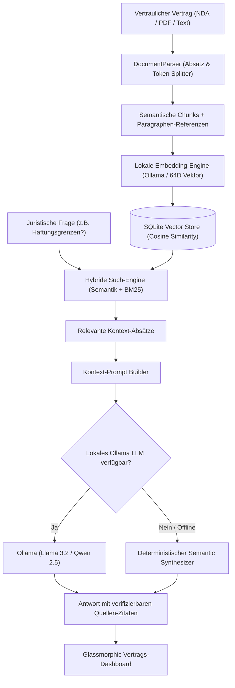

# 🛡️ Air-Gapped Local RAG Document & Contract Intelligence Hub

[](https://ollama.com/)
[](https://www.typescriptlang.org/)
[](https://sqlite.org/)
[](https://ollama.com/)
[](https://vitest.dev/)
[](https://tailwindcss.com/)
[](LICENSE)

> 🌐 **Sprache / Language:** [🇩🇪 Zur deutschen Version](#-deutsche-dokumentation) | [🇬🇧 Switch to English Version](#-english-documentation)

---

## 🇩🇪 Deutsche Dokumentation

Ein datenschutzkonformes, unternehmenstaugliches **Retrieval-Augmented Generation (RAG) Dokumenten- & Vertragsanalyse-System** für stark regulierte Branchen (Rechtsabteilungen, Finanzinstitute, Automotive, Medizintechnik). Funktioniert **100% offline (Air-Gapped)** – ohne Datenabfluss oder Telemetrie an externe US-Cloud-Anbieter.

---

### 🎯 Die unternehmerische Problemstellung & Lösung

#### Das DSGVO- & Compliance-Dilemma
Gemäß den europäischen Datenschutzvorgaben (DSGVO), ISO 27001 sowie unternehmensinternen Geheimhaltungsrichtlinien dürfen Rechtsabteilungen und Industrieunternehmen vertrauliche Lieferantenverträge, Geheimhaltungsvereinbarungen (NDAs), Patententwürfe oder Finanzprüfungen **nicht** an externe SaaS-KI-Modelle (OpenAI, Anthropic, Google) übermitteln.

#### Die Air-Gapped RAG Lösung
Dieses System bietet eine souveräne, lokale KI-Zentrale:
1. **Zero-Cloud Dokumentenaufnahme:** Liest Verträge ein, zerlegt sie semantisch in Absätze und extrahiert automatisch Paragraphen-Referenzen (`§ 1`, `§ 2`, `Präambel`).
2. **Hybride semantische Suche:** Kombiniert mathematische Cosine-Similarity Vektorsuche mit Keyword-Matching (BM25), um KI-Halluzinationen wirksam zu unterbinden.
3. **Nachvollziehbare Zitat-Verlinkung:** Jede generierte Aussage verlinkt direkt auf den Quell-Paragraphen. Ein Klick auf das Zitat scrollt im Dokumenten-Viewer direkt an die Fundstelle und hebt sie hervor.
4. **Automatischer Klausel-Risiko-Scanner:** Erkennt kritische Haftungsfallen (unbegrenzte Haftung, Folgeschäden, fehlende Haftungsdeckelung), überhöhte Vertragsstrafen (> 50.000 €) und unübliche Kündigungsfristen.
5. **Dual-Execution-Modus:** Bindet sich nativ an lokale **Ollama**-Modelle (`llama3.2`, `qwen2.5-coder`, `mistral`) an ODER schaltet automatisch auf eine deterministische Heuristik um – dadurch auf jedem Rechner oder CI-Runner ohne GPU sofort testbar.

---

### 🏗️ System-Architektur



---

### ✨ Hauptfunktionen

- **🔒 100% Offline & DSGVO-konform:** Keine Cloud-Calls, kein API-Key erforderlich, alle Daten verbleiben lokal in SQLite.
- **📄 Interaktiver Split-Screen Viewer:** Antwort-Chat auf der linken Seite mit klickbaren Quellen-Badges (`[Quelle: Paragraph X]`). Klick scrollt und markiert die Textstelle im Originaldokument auf der rechten Seite.
- **🛡️ Risiko-Radar (Legal Risk Audit):** Automatische Einstufung des Vertrages in `LOW`, `MEDIUM` oder `HIGH` Risiko mit Analyse kritischer Klauseln.
- **⚡ Integrierte SQLite Vektor-Datenbank:** Speichert Embeddings direkt als JSON-Vektoren mit mathematischer Cosine-Ähnlichkeitsberechnung in TypeScript/SQL.

---

### 🚀 Schnellstart

#### Voraussetzungen
- Node.js 20+ (LTS)
- *(Optional)* [Ollama](https://ollama.com/) lokal gestartet (z.B. mit `ollama run llama3.2` oder `llama3:instruct`)

#### Installation & Ausführung
```powershell
# 1. Repository klonen & Abhängigkeiten installieren
git clone https://github.com/Tom7668h/local-rag-contract-hub.git
cd local-rag-contract-hub
npm install

# 2. Server starten (Web-UI auf Port 3002)
npm start

# 3. Tests ausführen
npm test
```

Dashboard im Browser öffnen: 👉 **http://localhost:3002**

---

### 📡 REST-API Endpunkte

| Methode | Endpunkt | Beschreibung |
| :--- | :--- | :--- |
| `GET` | `/health` | Server-Gesundheitsstatus & DB-Verbindung |
| `GET` | `/api/documents` | Liste aller indexierten Verträge & Dokumente |
| `GET` | `/api/documents/:id` | Dokument-Details mit Paragraphen & Risikoprofil |
| `POST` | `/api/documents/ingest` | Neues Dokument hochladen, parsen & vektorisieren |
| `POST` | `/api/rag/query` | Juristische RAG-Anfrage mit Zitat-Verweisen |
| `GET` | `/api/rag/status` | Status der lokalen Ollama-KI-Verbindung |

---

<br><br>

---

## 🇬🇧 English Documentation

An enterprise-grade, privacy-first **Retrieval-Augmented Generation (RAG) Document & Contract Intelligence Hub** engineered for strictly regulated industries (legal departments, financial institutions, healthcare, and automotive OEMs). Operates **100% offline (Air-Gapped)** with zero cloud telemetry or data leaks to third-party US clouds.

---

### 🎯 The Enterprise Challenge & Solution

#### The GDPR & Compliance Bottleneck
Under European data protection regulations (GDPR / DSGVO), ISO 27001, and corporate confidentiality policies, legal departments and industrial enterprises cannot upload sensitive supplier contracts, NDAs, patent drafts, or audit logs to public SaaS LLMs (OpenAI, Anthropic, Google).

#### The Air-Gapped Solution
This hub provides a sovereign, local AI command center:
1. **Zero-Cloud Ingestion:** Ingests contracts, splits text into semantic paragraph chunks, and extracts section references (`§ 1`, `§ 2`, `Preamble`).
2. **Hybrid Semantic Retrieval:** Combines Cosine-Similarity vector search with keyword matching (BM25) to prevent hallucinations.
3. **Verifiable Citation Tracing:** Every generated statement links directly to the exact contract paragraph. Clicking a citation highlights the source text in real time.
4. **Automated Legal Risk Scanner:** Identifies critical liability traps (unlimited liability, consequential damages, missing caps), excessive contractual penalties (>50,000 €), and restrictive lock-in periods.
5. **Dual-Execution Mode:** Connects natively to local **Ollama** instances (`llama3.2`, `qwen2.5`, `mistral`) OR falls back to a deterministic semantic synthesizer, ensuring instant testability on any computer or CI runner without GPU hardware.

---

### ✨ Key Features

- **🔒 100% Offline & Private:** Zero external API calls, zero telemetry, everything is indexed and queried locally using SQLite.
- **📄 Interactive Split-Screen UI:** Chat interface on the left with clickable citation badges (`[Source: Paragraph X]`). Clicking automatically scrolls and highlights the source in the contract reader.
- **🛡️ Legal Risk Radar:** Automatically computes contract risk level (`LOW`, `MEDIUM`, `HIGH`) and flags dangerous clauses.
- **⚡ SQLite Vector Store:** Stores vector embeddings directly with Cosine Similarity math calculated on the fly.

---

### 🚀 Quickstart

#### Prerequisites
- Node.js 20+ (LTS)
- *(Optional)* [Ollama](https://ollama.com/) running locally (e.g. `ollama run llama3.2`)

#### Installation & Launch
```bash
# 1. Clone & install dependencies
git clone https://github.com/Tom7668h/local-rag-contract-hub.git
cd local-rag-contract-hub
npm install

# 2. Start server (Dashboard on port 3002)
npm start

# 3. Run automated tests
npm test
```

Open dashboard in browser: 👉 **http://localhost:3002**

---

### 🧪 Test Verification
```bash
npm test
```
```text
 ✓ tests/unit/document-parser.test.ts  (3 tests)
 ✓ tests/unit/risk-analyzer.test.ts    (3 tests)
 ✓ tests/unit/vector-store.test.ts     (2 tests)
 ✓ tests/integration/rag-api.test.ts   (3 tests)

 Test Files  4 passed (4)
      Tests  11 passed (11)
```

---

### 📄 License
MIT © Tom7668h
