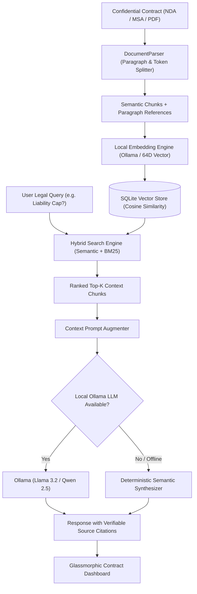

# 🛡️ Air-Gapped Local RAG Document & Contract Intelligence Hub

[](https://ollama.com/)
[](https://www.typescriptlang.org/)
[](https://sqlite.org/)
[](https://ollama.com/)
[](https://vitest.dev/)
[](https://tailwindcss.com/)
[](LICENSE)

A privacy-first, enterprise-grade **Retrieval-Augmented Generation (RAG) Document & Contract Intelligence Hub** designed for strictly regulated environments (legal firms, financial institutions, healthcare, and manufacturing). Operates **100% offline (Air-Gapped)** with zero telemetry or data leaks to third-party US clouds.

---

## 🎯 The Enterprise Challenge & Solution

### The GDPR & Compliance Bottleneck
Under European data protection regulations (GDPR / DSGVO), ISO 27001, and corporate trade-secret policies, legal departments and automotive OEMs cannot upload confidential supplier agreements, non-disclosure agreements (NDAs), patent blueprints, or financial audits to external SaaS LLMs (OpenAI, Anthropic, Google).

### The Air-Gapped Solution
This hub provides a sovereign, local AI command center:
1. **Zero-Cloud Ingestion:** Ingests contracts, splits text into semantic paragraph chunks with section reference extraction (`§ 1`, `§ 2`, `Präambel`).
2. **Hybrid Semantic Retrieval:** Combines mathematical Cosine-Similarity vector search with keyword matching (BM25) to prevent hallucinations.
3. **Verifiable Citation Tracing:** Every generated statement links directly to the exact contract paragraph and page number; clicking a source citation highlights the source text in real time.
4. **Automated Legal Risk Scanner:** Identifies critical liability traps (unlimited liability, consequential damages, missing liability caps), excessive contractual penalties (>50,000 €), and restrictive lock-in periods.
5. **Dual-Execution Mode:** Connects natively to local **Ollama** instances (`llama3.2`, `qwen2.5`, `mistral`) OR falls back to a deterministic semantic synthesizer, ensuring instant testability on any computer or CI runner without GPU hardware.

---

## 🏗️ System Architecture



---

## ⚖️ Legal Risk Detection Categories

| Clause Type | Trigger Patterns | Severity | Mitigation Recommendation |
| :--- | :--- | :--- | :--- |
| **Unlimited Liability** | `unbeschränkt`, `Folgeschäden`, `Produktionsstillstand` | 🔴 **CRITICAL** | Mandate contractual liability cap (e.g. 1x annual order value). |
| **No Liability Cap** | `Haftungshöchstgrenze ausgeschlossen` | 🔴 **CRITICAL** | Introduce customary insurance ceiling. |
| **Contractual Penalties** | `Vertragsstrafe pauschal > 50.000 €`, `verschuldensunabhängig` | 🟠 **HIGH** | Require proven fault (intent/gross negligence); cap penalty at max 5%. |
| **Excessive Lock-in** | `feste Grundlaufzeit > 3 Jahre`, `Kündigungsfrist > 6 Monate` | 🟡 **MEDIUM** | Negotiate regular 3-month termination notice. |
| **IP Transfer** | `Abtretung sämtlicher Erfindungen`, `exklusiv` | 🟠 **HIGH** | Separate Background IP from Foreground deliverables. |

---

## 🚀 Quickstart & Execution

### Prerequisites
- Node.js 18+ (tested on Node.js 22 LTS)
- *(Optional)* [Ollama](https://ollama.com/) running locally with `llama3.2` or any model

### 1. Installation
```bash
git clone https://github.com/Tom7668h/local-rag-contract-hub.git
cd local-rag-contract-hub
npm install
```

### 2. Run Test Suite (Vitest)
```bash
npm test
```
Runs 11 automated unit and integration tests covering vector cosine math, paragraph chunking, legal risk heuristic rules, and RAG question answering.

### 3. Build & Start the Hub
```bash
# Compile TypeScript
npm run build

# Start server
npm start
```
Open **[http://localhost:3002](http://localhost:3002)** in your browser to access the dashboard.

---

## 🌐 Web Dashboard Features

- **Split-Screen Workspace:** Left pane displays the active contract with color-coded risk flags; right pane provides an interactive AI query chat.
- **Clickable Citations:** Clicking any source citation (e.g. `[§ 3 VERTRAGSSTRAFE (S. 1)]`) scrolls directly to the referenced clause.
- **Risk Radar:** Computes an aggregated Legal Risk Score ($0 - 100$) based on detected clauses.
- **1-Click Demo Contract:** Instant seeding of a realistic automotive supplier NDA (ApexTech & Nordic Automotive Systems).
- **Document Uploader:** Drag & drop your own TXT, MD, or contract files for instant local vectorization.

---

## 🔌 REST API Endpoints

| Method | Endpoint | Description |
| :--- | :--- | :--- |
| `GET` | `/health` | Server health and environment status |
| `GET` | `/api/documents` | List all ingested documents and chunk metrics |
| `GET` | `/api/documents/:id` | Document details with chunks and risk flags |
| `POST` | `/api/documents/upload` | Ingest and vectorize a new document |
| `POST` | `/api/documents/seed-demo` | Ingests the 2026 automotive supplier demo NDA |
| `POST` | `/api/rag/ask` | Ask legal query against document with citations |
| `GET` | `/api/rag/risks/:documentId` | Structured risk evaluation summary |
| `GET` | `/api/rag/status` | Ollama connection telemetry and vector store stats |

---

## 📄 License
MIT License. Created by [Tom7668h](https://github.com/Tom7668h).
